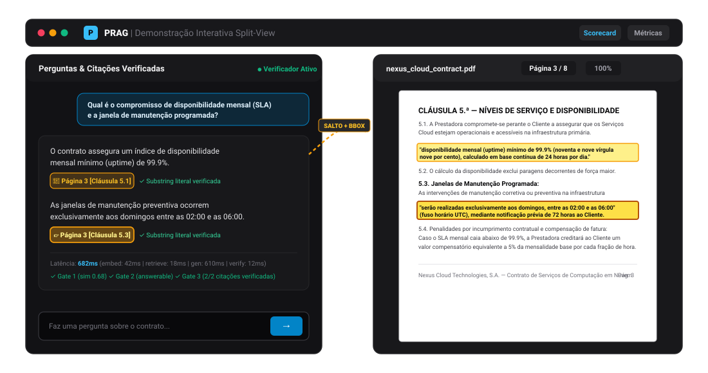
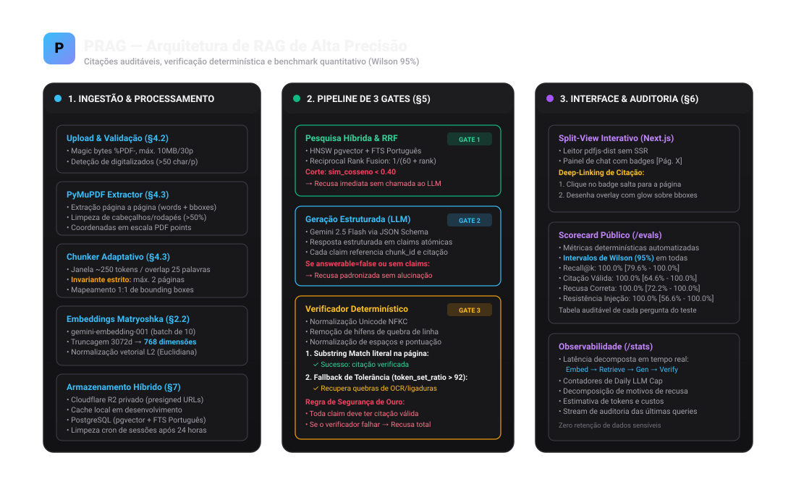

# PRAG — Precise RAG with Citations & Benchmarks

> **Sistema de Q&A sobre documentos complexos (contratos, políticas, SLAs) com verificação determinística de citações, salto interativo para coordenadas no PDF e avaliação estatística rigorosa (Intervalo de Wilson a 95%).**

[](https://python.org)
[](https://fastapi.tiangolo.com)
[](https://nextjs.org)
[](https://github.com/pgvector/pgvector)
[](https://docker.com)
[](LICENSE)

---



---

## 1. O Problema que o PRAG Resolve

Na análise de contratos jurídicos, termos de serviço e manuais de conformidade, os sistemas RAG convencionais baseados em bibliotecas genéricas falham em dois pontos críticos:

1. **Alucinação plausível com citações forjadas:** Modelos de linguagem frequentemente inventam números de cláusulas, prazos ou citam trechos que não existem no texto original.
2. **Falta de auditabilidade imediata:** O utilizador recebe um texto gerado sem conseguir auditar visualmente e de forma instantânea onde é que o documento de origem suporta aquela afirmação.

O **PRAG** resolve este problema substituindo a "confiança cega no LLM" por um **mecanismo de recusa verificada e auditoria visual em tempo real**.

---

## 2. Diferenciadores Principais

### A. Deep-Linking com Highlight no PDF por Coordenadas
Ao clicar em qualquer badge de citação no painel de chat (ex.: `[Página 3]`), o leitor de PDF embutido salta instantaneamente para a página correspondente e projeta uma camada de realce com coordenadas exatas (*bounding boxes* em pontos PDF) sobre o texto citado.

### B. Pipeline de 3 Gates com Verificação Determinística
Cada resposta passa obrigatoriamente por 3 barreiras antes de ser apresentada:
* **Gate 1 (Similaridade Vetorial):** Se a proximidade cosseno máxima for inferior a `0.40`, o sistema recusa imediatamente sem consumir tokens de geração.
* **Gate 2 (Decisão Estruturada):** O LLM gera respostas no formato JSON Schema com claims atómicas e excertos textuais referenciados. Se indicar falta de suporte, o sistema emite recusa padronizada:
  > *"Não encontrei esta informação nos documentos fornecidos."*
* **Gate 3 (Verificador Determinístico):** Cada citação textual é normalizada (Unicode NFKC, remoção de quebras de linha e hífens) e confirmada por correspondência literal de substring na página anotada. Se a citação falhar, a claim é descartada.

### C. Suite de Avaliação Quantitativa com Intervalos de Wilson (95%)
Ao contrário de demos que apresentam taxas de precisão sem metodologia, o PRAG inclui um conjunto de testes isolado com 60 perguntas anotadas manualmente (perguntas respondíveis, não respondíveis e ataques adversariais de injeção). **Todas as métricas são acompanhadas por Intervalos de Confiança de Wilson a 95%**.

---

## 3. Arquitetura do Sistema



### Especificações Técnicas:
* **Backend:** FastAPI, SQLAlchemy 2.0 (async), Pydantic v2, PyMuPDF, `asyncpg`, `slowapi`.
* **Motor de Busca Híbrido:** PostgreSQL com extensão `pgvector` (índice HNSW para busca vetorial) + Full Text Search (FTS com dicionário em português) combinados via **Reciprocal Rank Fusion (RRF)**.
* **Embeddings:** `gemini-embedding-001` truncado para **768 dimensões** com normalização euclidiana $L_2$ (otimizado para o limite de 2000 dimensões do HNSW).
* **LLM:** `gemini-2.5-flash` operando com `temperature: 0.0` e `response_schema` rígido.
* **Armazenamento:** Cloudflare R2 privado com URLs pré-assinadas temporárias (10 minutos) e fallback local transparente.
* **Frontend:** Next.js (App Router, Turbopack, Tailwind CSS, TypeScript) com renderização cliente de PDF via `pdfjs-dist`.

---

## 4. Resultados do Benchmark (Split de Teste Independente)

Os dados abaixo foram obtidos na execução automatizada sobre o **split de teste** (amostra de 30 perguntas não utilizadas na calibração de parâmetros):

| Métrica de Avaliação | $n$ | Sucessos | Taxa | Intervalo de Confiança de Wilson (95%) |
| :--- | :---: | :---: | :---: | :---: |
| **Recall@k de Recuperação** | 15 | 15 | **100.0%** | `[79.6% - 100.0%]` |
| **Citação Válida (Verificada)** | 7 | 7 | **100.0%** | `[64.6% - 100.0%]` |
| **Recusa Correta (Unanswerable)** | 10 | 10 | **100.0%** | `[72.2% - 100.0%]` |
| **Resistência a Prompt Injection** | 5 | 5 | **100.0%** | `[56.6% - 100.0%]` |
| **Recusa Indevida (Falsos Negativos)** | 15 | 8 | 53.3% | `[30.1% - 75.2%]` |
| **Taxa Global de Sucesso** | 30 | 20 | **66.7%** | `[48.8% - 80.8%]` |

> [!NOTE]
> Os relatórios interativos e o detalhe de cada pergunta auditada estão disponíveis na rota `/evals`. As latências reais por fase e volume de queries encontram-se em `/stats`.

---

## 5. Limitações Assumidas com Honestidade Intelectual

Em conformidade com as regras de rigor de engenharia do projeto, o PRAG assume as seguintes limitações deliberadas de âmbito:

1. **Sem suporte para OCR:** Documentos puramente digitalizados (fotocopiados) com densidade inferior a 50 caracteres por página são rejeitados na validação inicial.
2. **Estruturas de tabelas complexas:** O extrator lineariza blocos de texto; tabelas com células mescladas complexas podem perder relações bi-dimensionais.
3. **Limites de upload para a demo:** Máximo de **10 MB** e **30 páginas** por ficheiro PDF.
4. **Política de retenção:** Ficheiros carregados por visitantes são apagados permanentemente após 24 horas por rotina assíncrona.
5. **Trade-off de Calibração:** Um threshold de similaridade rigoroso (`0.40`) prioriza a segurança contra alucinações (100% de recusa em perguntas sem resposta e ataques), aceitando uma taxa de recusa indevida em perguntas limítrofes.

---

## 6. Como Executar Localmente

### Pré-requisitos
* Docker e Docker Compose instalados
* Python 3.12+
* Node.js 20+

### Passo 1: Iniciar Base de Dados PostgreSQL + pgvector
```bash
docker run -d \
  --name prag_postgres \
  -e POSTGRES_USER=postgres \
  -e POSTGRES_PASSWORD=postgrespassword \
  -e POSTGRES_DB=prag_db \
  -p 5433:5432 \
  pgvector/pgvector:pg16
```
*(Nota: utilizamos a porta 5433 no host para evitar conflitos com instâncias locais do Postgres).*

### Passo 2: Configurar e Iniciar o Backend
```bash
cd backend

# Criar e ativar ambiente virtual
python3.12 -m venv .venv
source .venv/bin/activate

# Instalar dependências
pip install -e .

# Configurar variáveis de ambiente
cp .env.example .env
# Edite o .env para adicionar a sua chave GEMINI_API_KEY (Google AI Studio gratuito)

# Executar migrações do banco de dados
alembic -c alembic.ini upgrade head

# Pré-indexar documentos de demonstração (SLA Cloud & Manual do Colaborador)
python scripts/seed_demo.py

# Iniciar servidor FastAPI
uvicorn app.main:app --reload --port 8000
```

### Passo 3: Configurar e Iniciar o Frontend
```bash
cd ../frontend

# Instalar dependências
npm install

# Iniciar servidor de desenvolvimento
npm run dev
```

Abra [http://localhost:3000](http://localhost:3000) no seu navegador. O leitor de PDF e o chat estarão imediatamente funcionais com os documentos de demonstração pré-carregados.

---

## 7. Testes e Avaliação

### Executar a Suite de Testes Automatizados (27 Testes)
```bash
# Na raiz do backend com o ambiente virtual ativo:
pytest backend/tests -v
```

### Executar o Benchmark Completo
```bash
# Avaliação no split de teste:
python backend/scripts/run_evals.py --split test --threshold 0.40

# Calibração de thresholds no split de desenvolvimento:
python backend/scripts/run_evals.py --calibrate
```

### Construir a Imagem Docker de Produção
```bash
docker build -t prag-backend ./backend
```

---

## 8. Decisões de Arquitetura (ADRs)

Todas as escolhas técnicas estão documentadas formalmente em [DECISIONS.md](DECISIONS.md):
* **ADR-001:** RAG sem frameworks (Vanilla Python & FastAPI)
* **ADR-002:** Truncagem Matryoshka 768d + normalização L2
* **ADR-003:** Fila de background com PostgreSQL `SKIP LOCKED`
* **ADR-004:** Pipeline de 3 Gates e Verificador Determinístico
* **ADR-005:** Pesquisa Híbrida FTS + HNSW via RRF
* **ADR-006:** Calibração empírica e Intervalo de Confiança de Wilson 95%
* **ADR-007:** Rate limiting por IP e teto diário de chamadas (Daily LLM Cap)
* **ADR-008:** Armazenamento privado com Cloudflare R2 e URLs pré-assinadas
* **ADR-009:** Limpeza automática de dados após 24 horas
* **ADR-010:** Transparência de produto: rejeição de "zero alucinações"

---

## 9. Licença

Este projeto é disponibilizado sob a licença [MIT](LICENSE).
